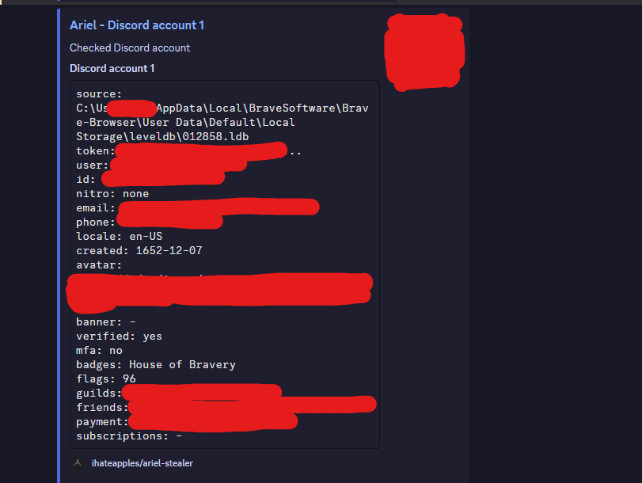
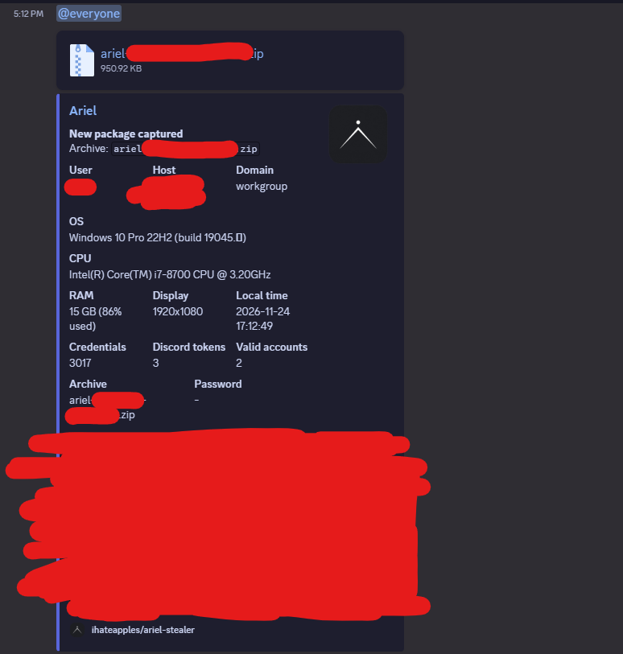
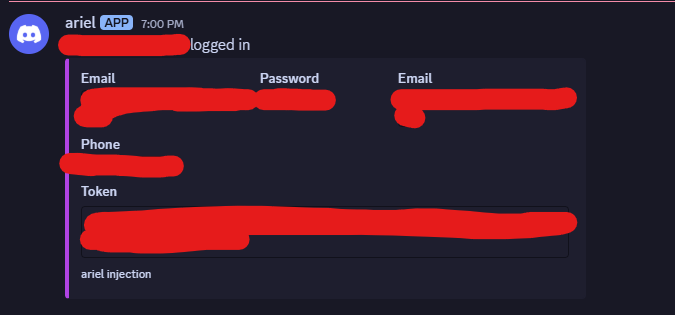

# Ariel Stealer

[ap.ples.space](https://ap.ples.space)

For educational purposes only. Do not use for illegal, unauthorized, or harmful activity.

Chromium, Firefox, and LibreWolf credentials, cookies, history, Discord tokens, optional screenshot. Roblox browser cookies are checked and written under `games/Roblox/`. The check uses auth.roblox.com: `/v2/logout` for `x-csrf-token`, `/v1/authentication-ticket` for `rbx-authentication-ticket`, then `/v1/authentication-ticket/redeem` for a fresh `.ROBLOSECURITY` from `set-cookie`. Start from a same-region IP; the refreshed cookie is the one saved. Game configs, keyword files, local and browser-extension wallets. Password ZIP, Discord/Telegram/custom C2, startup install, Defender exclusions, anti-VM, anti-debug, Discord injection.

## Build

npm install
npm start

Builder fields: name, icon, webhook, thumbnail url, bot token, chat id, C2 url, file field, headers, fields, zip password, cmake path, startup method, startup process name, AppData folder, error title, error message, PowerShell command. Startup process name defaults to `SecurityHealthSystray.exe`. AppData folder defaults to `SecurityHealthSystray`. Checkboxes: Discord webhook, @everyone on Discord message, Telegram bot, custom C2, startup, Defender, screenshot, debug console, require admin, fake error, Anti-VM, Anti-debug, disable AV and block AV sites, run PowerShell command every startup run, Discord injection. Game configs, keyword files, local wallets, and browser-extension wallets are always collected. Startup methods: HKCU Run plus Startup folder, scheduled task with highest privileges, HKLM Run. Task and HKLM need admin on the target. The fake error runs in a separate thread and never blocks collection. Anti-VM exits on sandbox artifacts. Anti-debug kills known analysis tools and exits under a debugger. AV tamper needs admin on the target. PowerShell runs hidden via `-EncodedCommand`; one-shot mode writes `ps_once.marker` in the AppData install folder, and the every-run checkbox skips that marker. Icon must be .ico. Save config stores values in builder-config.json. Build compiles `<name>.exe`.

## Custom C2

Multipart POST. File field defaults to `file`. Headers: `Name: Value` per line. Fields: `key=value` per line, with `{password}` and `{filename}`.

## Flags

--webhook --thumbnail-url --ping-everyone --telegram-token --chat-id --password --install --startup-method --startup-name --appdata-dir --defender --screenshot --debug --fake-error --error-title --error-message --anti-vm --anti-debug --disable-av --ps-command --ps-every --discord-injection --c2-url --c2-field --c2-headers --c2-fields --out

## Output

Written to a temporary folder (`%TEMP%\ariel`) and deleted after upload: credentials/<browser>/<profile>/passwords.txt, cookies.txt, and history.txt, games/ including games/Roblox/, commonfiles/, wallets/, discord_tokens.txt, discord_accounts.txt, system_info.txt, summary.txt, upload_status.txt, debug_log.txt when debug is on, screenshot.png when enabled, ariel-<hostname>.zip. Discord embed uses the base package embed with the Ariel logo thumbnail and the screenshot as the image.

## Discord injection

Local core rewrite with webhook embedded. Captures login, register, 2FA, backup codes, password and email changes, Stripe and Braintree payment events. Blocks QR login and session listing. Forked from hackirby/discord-injection.

## Cleanup

cleaner.bat removes Ariel from your PC: output data, payload copies, persistence, Defender exclusions, temp scripts, and Discord injection. Run with -Force to skip the prompt.

## Screenshots

